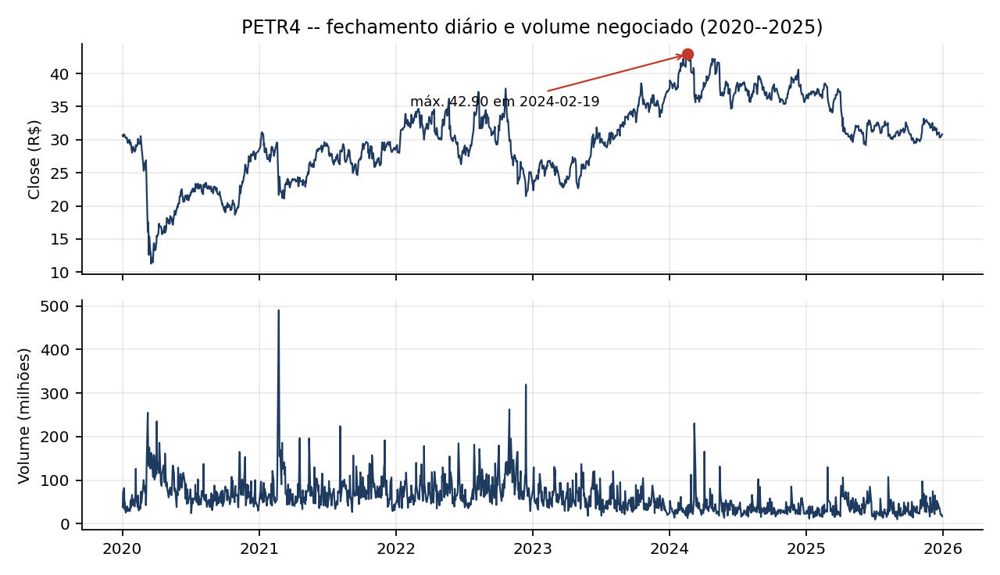
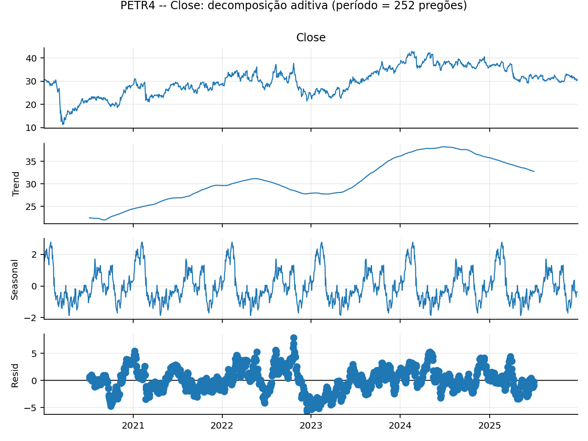
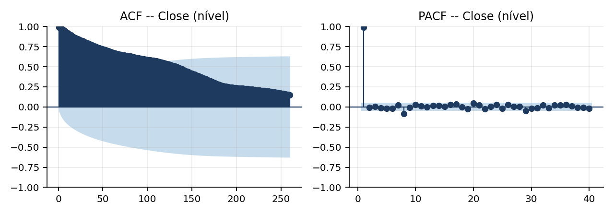
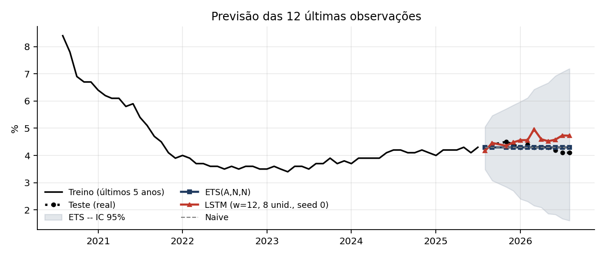

# Séries temporais: análise da PETR4 e previsão do desemprego nos EUA

Dois estudos de séries temporais com dados reais: uma **análise exploratória** completa do preço e do volume da ação PETR4 e uma **comparação de modelos de previsão** (ETS contra LSTM) para a taxa de desemprego dos EUA.

Atividades da disciplina **Mineração de Séries Temporais** da Especialização em Inteligência Artificial e Ciência de Dados da PUCPR (Prof. Vinícius Mourão Alves de Souza). O Trabalho Final da mesma disciplina está em [classificacao-gestos-mouse](https://github.com/cesarpachecowillian/classificacao-gestos-mouse).

## 1. Análise exploratória da PETR4

Cotações diárias da PETR4 (Yahoo Finance, 02/01/2020 a 30/12/2025): 1.494 pregões, 5 variáveis (`Open`, `High`, `Low`, `Close`, `Volume`).



O que foi investigado:

* **Tipo e frequência da série**: multivariada, 1 observação por dia útil (cerca de 249 por ano); intervalos de 3 dias são fins de semana e os demais saltos são feriados sem pregão.
* **Tendência e ciclos**: o fechamento termina praticamente onde começou (R$ 30,70 para R$ 30,82), mas com tendência local não monotônica: mínima de R$ 11,29 no crash de março de 2020, máxima de R$ 42,90 em 19/02/2024 e ciclos irregulares ligados ao cenário econômico e ao preço do petróleo, não a um calendário fixo.
* **Sazonalidade**: decomposição e médias por dia da semana mostram que não há sazonalidade relevante (força sazonal de 0,19).
* **Estacionariedade**: os testes ADF (p = 0,15) e KPSS (p = 0,01) concordam que o fechamento **não é estacionário**; após uma diferença, ambos indicam estacionariedade. O fechamento se comporta como um passeio aleatório, I(1).
* **Autocorrelação**: ACF do fechamento decai muito devagar (0,99 no lag 1), enquanto a ACF da série diferenciada some já no lag 1. O volume tem tendência de queda e memória curta.

<p>


</p>

## 2. Previsão da taxa de desemprego (UNRATE)

Série mensal do FRED de 1948 a 2026 (943 observações). Tarefa: prever as **últimas 12 observações** e comparar ETS com LSTM.

**Protocolo**

* **Holdout temporal**: os 12 últimos meses são o teste; nada é embaralhado e nenhuma escala ou parâmetro é ajustado com o teste.
* **ETS**: seis configurações candidatas (com e sem tendência amortecida e sazonalidade), escolhidas pelo **AICc no treino**.
* **LSTM**: arquitetura direta multi-saída (janela de entrada, camada LSTM, 12 saídas), `MinMaxScaler` ajustado só no treino, early stopping, configuração escolhida pelo erro de **validação** e resultado reportado em **5 sementes**.
* **Baselines** (média, naive, drift) para medir a dificuldade do problema.

**Resultado**

| Modelo | RMSE no teste |
|---|---|
| **ETS(A,N,N), α = 0,9999** | **0,116** |
| Naive | 0,115 |
| Drift | 0,118 |
| LSTM (janela 12, 8 unidades) | 0,371 ± 0,017 |
| Média histórica | 1,377 |



**Leitura**: o ETS escolhido tem α praticamente igual a 1, ou seja, ele se reduz ao modelo naive ("o próximo mês será igual ao último"). Em uma série com alta persistência e horizonte curto, o modelo simples vence com folga: a LSTM erra 3,2 vezes mais em RMSE. É o tipo de resultado que justifica sempre comparar modelos sofisticados com baselines.

## Estrutura

```
.
├── 01-analise-petr4/
│   ├── analise_petr4.py        # gera figuras/ e resultados.json
│   ├── PETR4.csv
│   ├── figuras/
│   ├── resultados.json
│   └── Atividade-Aula1-PETR4.pdf / .tex
└── 02-forecasting-unrate/
    ├── forecasting_unrate.py   # gera figuras/ e resultados.json
    ├── UNRATE.csv
    ├── figuras/
    ├── resultados.json
    └── Atividade-Aula2-UNRATE.pdf / .tex
```

## Como executar

```bash
pip install -r requirements.txt
cd 01-analise-petr4 && python analise_petr4.py
cd ../02-forecasting-unrate && python forecasting_unrate.py   # treina a LSTM em 5 sementes, leva alguns minutos
```

## Dados

* **PETR4**: cotações diárias da PETR4.SA no Yahoo Finance, de 2020 a 2025.
* **UNRATE**: *Unemployment Rate*, U.S. Bureau of Labor Statistics, obtida no [FRED](https://fred.stlouisfed.org/series/UNRATE).

## Tecnologias

Python, pandas, NumPy, statsmodels (decomposição, ADF, KPSS, ACF/PACF, ETS), TensorFlow/Keras (LSTM), scikit-learn, Matplotlib, LaTeX.

## Autor

**César Willian Pacheco**
